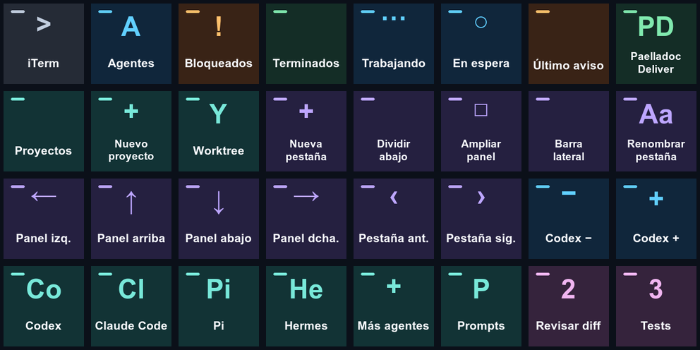

# Herdr Stream Deck XL Profile for macOS

[Español](#perfil-de-stream-deck-xl-para-herdr-en-macos) · [English](#herdr-shortcuts-for-coding-agents) · [Download the Stream Deck profile](Herdr-XL-Agentes.streamDeckProfile?raw=true)

A ready-to-import Elgato Stream Deck XL profile for Herdr TUI on macOS, with keyboard shortcuts and menus for Codex, Claude Code, Pi, and Hermes.



## Perfil de Stream Deck XL para Herdr en macOS

Un perfil para gestionar agentes de programación desde un **Stream Deck XL de 32 teclas en macOS**. Cambia de proyecto o de panel, encuentra agentes que esperan una decisión y abre menús dedicados de Codex, Claude Code, Pi y Hermes.

### Cómo importar el perfil en Elgato Stream Deck

1. Descarga [Herdr-XL-Agentes.streamDeckProfile](Herdr-XL-Agentes.streamDeckProfile?raw=true), ábrelo con doble clic y confirma la importación en la aplicación de Elgato.
2. Abre [Herdr TUI](https://herdr.dev/tui/docs/) en un terminal y déjalo en primer plano antes de usar el perfil.
3. Este perfil asume un prefijo **Ctrl+A** en Herdr. Si usas **Ctrl+B**, cambia los atajos en Stream Deck o configura el prefijo de Herdr como se indica abajo.
4. Si macOS te lo solicita, permite que Stream Deck envíe pulsaciones desde **Ajustes del Sistema → Privacidad y seguridad → Accesibilidad**.

### Mapa de teclas y atajos de Herdr

| Fila | Acciones |
| --- | --- |
| 1 · Estado | iTerm, selector de agentes, bloqueados, terminados, trabajando, en espera, último aviso y Paelladoc Deliver. |
| 2 · Proyectos | Selector de proyectos, espacio nuevo, worktree, pestaña nueva, dividir abajo, ampliar panel, barra lateral y renombrar pestaña. |
| 3 · Navegación | Moverse entre paneles y pestañas, y bajar o subir el esfuerzo en Codex. |
| 4 · Agentes | Menús de Codex, Claude Code, Pi y Hermes. Más agentes incluye OpenCode, Gemini, Cursor, Copilot, Grok, Kimi, Qwen y Crush. También hay prompts de revisión y tests. |

- **Agentes** abre el selector de Herdr. **Bloqueados** filtra a quienes esperan una respuesta o aprobación. **Último aviso** salta al panel que generó la notificación.
- **Proyectos** enfoca la barra lateral. Usa **↑ / ↓** y **Enter** para elegir. **Aa** cambia el nombre de la pestaña activa.
- **Worktree** abre una pestaña, confirma el nombre y deja preparado `herdr worktree create --branch `. Desde un repositorio Git, añade el nombre de la rama y pulsa **Enter**.
- Los botones de texto preparan el comando o prompt para que lo revises y envíes. Los atajos de navegación actúan al pulsarlos. La disponibilidad de los comandos depende del agente y de su versión.

### Ajustes y compatibilidad

Añade o actualiza estas claves en la sección `[keys]` de tu configuración de Herdr. Si la sección ya existe, intégralas en ella. iTerm debe pasar las combinaciones con **Option** como Meta para que funcionen los atajos Alt.

```toml
[keys]
prefix = "ctrl+a"
focus_pane_left = "alt+h"
focus_pane_down = "alt+j"
focus_pane_up = "alt+k"
focus_pane_right = "alt+l"
previous_tab = "alt+left"
next_tab = "alt+right"
split_horizontal = "prefix+minus"
```

El botón **iTerm** apunta a `/Applications/iTerm.app`. **Paelladoc Deliver** envía **F8** y requiere que ese atajo esté configurado en tu Herdr. **Worktree** presupone que Herdr pide el nombre al crear una pestaña. Si tu versión de Herdr lo pide también al pulsar **Abrir** en un menú de agentes, abre la pestaña, confirma su nombre y ejecuta el CLI correspondiente desde el shell.

El perfil se preparó para macOS y el Stream Deck XL. Los modelos con otra distribución de teclas y Windows requieren una adaptación.

### Regenerar el perfil

Con Python 3 e ImageMagick instalados en macOS, ejecuta:

```sh
python3 build_profile.py
```

El script regenera el archivo importable en la raíz del repositorio. Puedes editar las acciones, etiquetas y colores en [build_profile.py](build_profile.py).

## Herdr shortcuts for coding agents

A profile for managing coding agents from a **32-key Stream Deck XL on macOS**. Switch projects and panes, find agents that need input, and open dedicated menus for Codex, Claude Code, Pi, and Hermes.

### How to import the Elgato Stream Deck profile

1. Download [Herdr-XL-Agentes.streamDeckProfile](Herdr-XL-Agentes.streamDeckProfile?raw=true), double-click it, and accept the import in the Elgato app.
2. Open [Herdr TUI](https://herdr.dev/tui/docs/) in your terminal and keep it in the foreground when using the profile.
3. The profile expects **Ctrl+A** as the Herdr prefix. If you use **Ctrl+B**, edit the Stream Deck shortcuts or update your Herdr settings using the example above.
4. If macOS prompts you, allow Stream Deck to send keystrokes in **System Settings → Privacy & Security → Accessibility**.

### 32-key layout and Herdr keybindings

| Row | Actions |
| --- | --- |
| 1 · Status | iTerm, agent picker, blocked, done, working, idle, last notification, and Paelladoc Deliver. |
| 2 · Projects | Workspace picker, new workspace, worktree, new tab, split down, zoom pane, sidebar, and rename tab. |
| 3 · Navigation | Move between panes and tabs, and decrease or increase Codex effort. |
| 4 · Agents | Menus for Codex, Claude Code, Pi, and Hermes. More Agents includes OpenCode, Gemini, Cursor, Copilot, Grok, Kimi, Qwen, and Crush. Code-review and test prompts are also available. |

- **Agentes** opens the Herdr picker. **Bloqueados** shows agents waiting for input or approval. **Último aviso** jumps to the pane that raised the last notification.
- **Proyectos** focuses the workspace sidebar. Use **↑ / ↓** and **Enter** to select. **Aa** renames the active tab.
- **Worktree** opens a tab, confirms its name, and stages `herdr worktree create --branch `. Start from a Git repository, append the branch name, and press **Enter**.
- Text keys stage commands and prompts for review before you submit them. Navigation shortcuts take effect immediately. Command availability varies by client and version.

### Settings and compatibility

Merge the `[keys]` entries from the Spanish section into your Herdr configuration. Configure iTerm to send **Option** as Meta if the Alt shortcuts do not reach Herdr.

**iTerm** expects `/Applications/iTerm.app`. **Paelladoc Deliver** sends **F8** and requires a matching binding in your Herdr configuration. **Worktree** assumes Herdr prompts for the new tab name. If Herdr also prompts for a tab name when you use an agent menu's launch key, open the tab, confirm its name, and run the agent CLI from the shell.

The bundled profile targets macOS and the Stream Deck XL. Windows and devices with different button layouts need their own adaptation. The bundled button labels are in Spanish.

### Rebuild the profile

With Python 3 and ImageMagick installed on macOS, run:

```sh
python3 build_profile.py
```

This regenerates the importable profile at the repository root. Edit [build_profile.py](build_profile.py) to change actions, labels, or colors.
